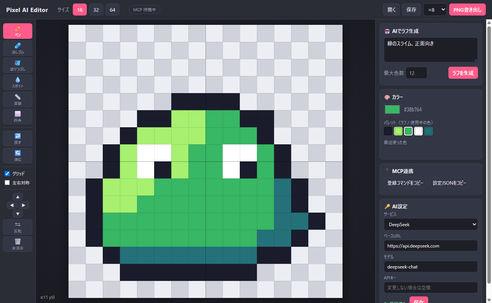

<p align="center"></p>

# Pixel AI Editor

[日本語](README.md) | **English**

A pixel art editor for **16×16 to 512×512** sprites (16 / 32 / 64 / 128 / 256 / 512) (Windows desktop app). AI sketches a rough draft from your prompt, and you refine it by hand.
It ships with an MCP server, so any MCP-capable AI agent (Claude, Cursor, VS Code, Gemini CLI, …) can draw on the canvas too.

**🌐 Website:** https://motchan2000.github.io/pixel-ai-editor/en/
**⬇️ Download:** [Latest release](https://github.com/motchan2000/pixel-ai-editor/releases/latest)



> The app UI is currently in Japanese. The key labels are translated below.

## Features
- **AI rough drafts** — describe a sprite and get it on the canvas at the size and color count you choose. Show it as a semi-transparent underlay to trace over it.
- **Bring your own AI** — DeepSeek, OpenAI, Anthropic (Claude), Google Gemini, OpenRouter, Ollama / LM Studio (local, no key), or any OpenAI-compatible API.
- **Editing toolkit** — pen, eraser, fill, eyedropper, line, rectangle, mirror drawing, shift, flip, undo/redo.
- **MCP server** — AI agents can draw, inspect and export, live in the running app.
- **Export** — PNG (1× / 8× / 16×) and a JSON project file.

## Install
1. Download `Pixel-AI-Editor-Setup-x.y.z.exe` from [Releases](https://github.com/motchan2000/pixel-ai-editor/releases/latest) and run it.
   - The installer is not code-signed, so Windows SmartScreen may warn you. Click “More info” → “Run anyway”.
2. In the **AI設定** (AI settings) panel at the bottom right, choose a service, enter your API key and press **保存** (Save).
   - Base URL and model name can be changed freely.
   - Keys are stored only on your PC, in `%APPDATA%\pixel-ai-editor\settings.json`.

## Usage
1. Pick a size (16 / 32 / 64 / 128 / 256 / 512) at the top. Mouse wheel zooms, middle-drag or Space+drag pans, `0` fits the canvas.
   - At 128 and above, AI roughs are generated at 64×64 and upscaled.
2. Type a prompt in the right panel and press **ラフを生成** (Generate). The draft replaces the canvas (Ctrl+Z restores the previous drawing).
3. Refine it with the tools. Turn on **下絵として表示** (Show as underlay) to trace the draft.
4. Press **PNG書き出し** (Export PNG) or **保存** (Save project).

| UI label | Meaning |
|---|---|
| ペン / 消しゴム / 塗りつぶし / スポイト / 直線 / 四角 | Pen / Eraser / Fill / Eyedropper / Line / Rectangle |
| 戻す / 進む | Undo / Redo |
| グリッド / 左右対称 | Grid / Mirror drawing |
| 反転 / 全消去 | Flip / Clear all |
| 開く / 保存 | Open / Save project |

| Key | Action |
|---|---|
| B / E / G / I / L / R | Pen / Eraser / Fill / Eyedropper / Line / Rectangle |
| Right click | Erase |
| Alt + click | Eyedropper |
| M | Toggle mirror drawing |
| Ctrl+Z / Ctrl+Y | Undo / Redo |
| Ctrl+S | Save project |

## MCP (let AI agents draw)
The **MCP連携** panel has two buttons that copy a config for your PC:

- **登録コマンドをコピー** — a `claude mcp add …` command for Claude Code
- **設定JSONをコピー** — an `mcpServers` JSON block for Claude Desktop, Cursor, Windsurf, Gemini CLI, LM Studio, etc.

For VS Code (`.vscode/mcp.json`), put the same entry under `"servers"` and add `"type": "stdio"`.
For Codex CLI (`~/.codex/config.toml`), use `[mcp_servers.pixel-editor]` with the same `command`, `args` and `env`.

The installed app runs the MCP server itself, so Node.js is not required. Drawing appears live in the editor (it launches automatically if closed), and the **MCP** badge in the header lights up while an agent is working.

| Tool | Description |
|---|---|
| `open_editor` | Launch / focus the editor |
| `get_canvas` | Current sprite as a text grid + PNG image |
| `new_canvas` | New 16–512 canvas |
| `draw_rows` | Draw a text grid with a palette (`.` = erase, `_` = keep) |
| `set_pixels` / `fill` / `draw_line` / `draw_rect` | Fine-grained drawing |
| `clear_canvas` / `undo` / `redo` | Clear and history |
| `generate_rough` | Generate a draft with the AI service set in the app |
| `export_png` | Save as a PNG file |

How it works: on launch the editor listens on a random port on `127.0.0.1` and writes the port and a one-time token to `%APPDATA%\pixel-ai-editor\bridge.json`. The MCP server (`mcp-server.mjs`) reads it to connect.

## Run from source
Requires Node.js 20+.
```
git clone https://github.com/motchan2000/pixel-ai-editor.git
cd pixel-ai-editor
npm install
npm start
```
- Set the API key in the app, or via environment variables (or `.env`): `DEEPSEEK_API_KEY` / `OPENAI_API_KEY` / `ANTHROPIC_API_KEY` / `GEMINI_API_KEY` / `OPENROUTER_API_KEY`
- Register MCP (source build): `claude mcp add pixel-editor -s user -- node <this folder>/mcp-server.mjs`
- Build the installer: `npm run dist` (output in `dist/`)
- Tests: `npm test`, and `node test/mcp-e2e.mjs` for an end-to-end MCP run (opens the editor)

## License
[MIT](LICENSE)
