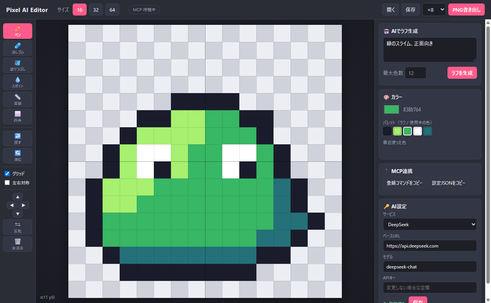

<p align="center"></p>

# Pixel AI Editor

AI がドット絵のラフを描き、それを自分で手直しできる **16×16 / 32×32 / 64×64** 用のドット絵エディタ（Windows デスクトップアプリ）。
MCP に対応しているので、Claude から直接キャンバスに描かせることもできます。

**🌐 紹介ページ:** https://motchan2000.github.io/pixel-ai-editor/
**⬇️ ダウンロード:** [最新リリース](https://github.com/motchan2000/pixel-ai-editor/releases/latest)



## 特長
- **AI ラフ生成** — お題を書くと AI が指定サイズのドット絵を描いてキャンバスに置きます。半透明の下絵としてなぞることもできます。
- **手直し用のツール一式** — ペン、消しゴム、塗りつぶし、スポイト、直線、四角、左右対称、移動、反転、Undo/Redo。
- **MCP 対応** — Claude Code / Claude Desktop から描画・確認・書き出しができ、起動中のアプリにリアルタイムで反映されます。
- **書き出し** — PNG（×1 / ×8 / ×16）とプロジェクトファイル（JSON）。

## インストール
1. [Releases](https://github.com/motchan2000/pixel-ai-editor/releases/latest) から `Pixel-AI-Editor-Setup-x.y.z.exe` をダウンロードして実行
   - 署名していないため Windows SmartScreen の警告が出ることがあります。「詳細情報」→「実行」で進めてください。
2. 起動したら右下の「AI設定」で使うサービスを選び、APIキーを入力して保存
   - 対応: DeepSeek / OpenAI / Anthropic (Claude) / Google Gemini / OpenRouter / Ollama・LM Studio（ローカル、キー不要）/ その他 OpenAI 互換 API
   - ベースURL とモデル名は自由に変更できます
   - キーはこの PC の `%APPDATA%\pixel-ai-editor\settings.json` にのみ保存されます。

## 使い方
1. 上部でサイズ（16 / 32 / 64）を選ぶ
2. 右の欄にお題を書いて「ラフを生成」→ キャンバスに反映（Ctrl+Z で元に戻せる）
3. ツールで手直し。「下絵として表示」でラフを半透明で重ねてなぞることも可能
4. 「PNG書き出し」または「保存」

| キー | 機能 |
|---|---|
| B / E / G / I / L / R | ペン / 消しゴム / 塗りつぶし / スポイト / 直線 / 四角 |
| 右クリック | 消す |
| Alt+クリック | スポイト |
| M | 左右対称描画 ON/OFF |
| Ctrl+Z / Ctrl+Y | 元に戻す / やり直し |
| Ctrl+S | プロジェクト保存 |

## MCP（Claude から操作）
アプリ右側の「MCP連携」にあるボタンで、この PC 用の登録設定をコピーできます。

- **Claude Code 用コマンド** … ターミナルに貼り付けて実行
- **Claude Desktop 用JSON** … `%APPDATA%\Claude\claude_desktop_config.json` の `mcpServers` に追記

インストール版はアプリ自身が MCP サーバーとして動くので、Node.js は不要です。
Claude からの操作は起動中のエディタに即反映され（未起動なら自動で起動）、ヘッダーの「MCP」バッジが青く光ります。

| ツール | 内容 |
|---|---|
| `open_editor` | エディタを起動・前面表示 |
| `get_canvas` | 現在の絵を文字グリッド＋PNG画像で取得 |
| `new_canvas` | 16/32/64 の新規キャンバス |
| `draw_rows` | 文字グリッド＋パレットでまとめて描く（`.`=消去, `_`=そのまま） |
| `set_pixels` / `fill` / `draw_line` / `draw_rect` | 細かい描画 |
| `clear_canvas` / `undo` / `redo` | 全消去・取り消し |
| `generate_rough` | アプリの「AI設定」のサービスでラフ生成 |
| `export_png` | PNG ファイルに保存 |

仕組み: エディタは起動時に `127.0.0.1` のランダムなポートで待ち受け、ポートと使い捨てトークンを `%APPDATA%\pixel-ai-editor\bridge.json` に書き出します。MCP サーバー（`mcp-server.mjs`）はそれを読んで接続します。

## ソースから動かす
Node.js 20 以上が必要です。
```
git clone https://github.com/motchan2000/pixel-ai-editor.git
cd pixel-ai-editor
npm install
npm start
```
- APIキーは画面から設定するか、環境変数（または `.env`）に `DEEPSEEK_API_KEY` / `OPENAI_API_KEY` / `ANTHROPIC_API_KEY` / `GEMINI_API_KEY` / `OPENROUTER_API_KEY` を設定
- MCP 登録（ソース版）: `claude mcp add pixel-editor -s user -- node <このフォルダ>/mcp-server.mjs`
- インストーラーのビルド: `npm run dist`（`dist/` に出力）

### テスト
- `npm test` … AI 応答のパース処理
- `node test/mcp-e2e.mjs` … MCP クライアントとして全ツールを呼ぶ通しテスト（エディタが開きます）

## ライセンス
[MIT](LICENSE)
