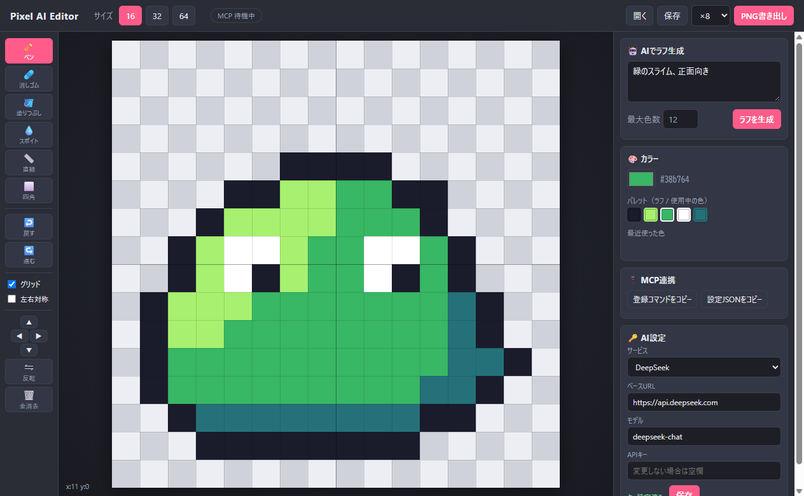
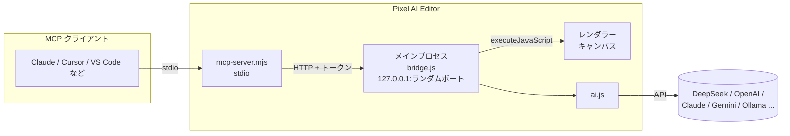

<!--
Qiita 投稿用メモ（この部分は貼り付けない）
タイトル: AIがラフを描いて人が仕上げる、MCP対応のドット絵エディタを作った
タグ（最大5つ）: Electron, MCP, ドット絵, 生成AI, 個人開発
※ 画像は GitHub の raw URL を使っています。Qiita に直接アップロードしてもOK。
-->

## はじめに

16×16・32×32・64×64 のドット絵を描くための Windows アプリ **Pixel AI Editor** を作りました。

「赤いスライム」のようにお題を書くと AI がラフ（下絵）を描き、それを自分で手直しして仕上げる、というツールです。AI に全部描かせるのではなく、**下絵づくりだけ AI に任せて、こだわりたい部分は自分の手で直す**のがコンセプトです。

さらに **MCP サーバーを内蔵**していて、Claude や Cursor などの AI エージェントから「32×32 で宝箱を描いて」と頼むと、起動中のエディタにリアルタイムで描かれていきます。



- 紹介ページ: https://motchan2000.github.io/pixel-ai-editor/
- GitHub: https://github.com/motchan2000/pixel-ai-editor
- ダウンロード: https://github.com/motchan2000/pixel-ai-editor/releases/latest

無料・オープンソース（MIT）です。

## できること

- **AI でラフ生成**: お題・サイズ・最大色数を指定すると、ドット絵がキャンバスに置かれる
- **好きな AI を使える**: DeepSeek / OpenAI / Claude / Gemini / OpenRouter / Ollama・LM Studio（ローカル）/ その他 OpenAI 互換 API
- **手直し用ツール**: ペン・消しゴム・塗りつぶし・スポイト・直線・四角・左右対称・移動・反転・Undo/Redo
- **下絵モード**: AI のラフを半透明で重ねて、上からなぞって描き直せる
- **MCP 対応**: AI エージェントから描画・確認・PNG 書き出しができる
- **書き出し**: PNG（×1 / ×8 / ×16）とプロジェクトファイル

## 使い方

1. [Releases](https://github.com/motchan2000/pixel-ai-editor/releases/latest) からインストーラーをダウンロードして実行
2. 右下の「AI設定」でサービスを選び、API キーを入力して保存（Ollama などのローカル LLM ならキー不要）
3. サイズを選んでお題を入力し、「ラフを生成」
4. 手直しして「PNG書き出し」

ここからは、作るときに工夫したところを書いていきます。

## 構成

Electron 製です。全体像はこんな感じです。



| ファイル | 役割 |
|---|---|
| `ai.js` | AI 呼び出しと応答のパース |
| `main.js` | ウィンドウ・設定・IPC・MCP 命令の振り分け |
| `bridge.js` | MCP サーバーからの命令を受けるローカル HTTP 窓口 |
| `mcp-server.mjs` | MCP サーバー本体（stdio） |
| `renderer/editor.js` | キャンバスと描画ツール |
| `renderer/mcp.js` | MCP の命令をキャンバスに反映 |

## 工夫1: LLM にドット絵を描かせる形式

LLM は画像を直接出力できないので、**1文字 = 1ピクセルの文字列グリッド**と、文字→色のパレットを JSON で返してもらいます。

```json
{
  "palette": { ".": "transparent", "o": "#1a1c2c", "g": "#38b764", "l": "#a7f070" },
  "rows": [
    "......oooo......",
    "....oollggoo....",
    "...ollllgggo...."
  ]
}
```

座標付きのピクセル配列（`[{x, y, color}, ...]`）にするより出力トークンがずっと少なく、LLM 自身も形を把握しやすいのが利点です。

ただし LLM は行数や文字数をよく間違えるので、受け取り側で補正しています。

- 行数・文字数が足りなければ透明で埋め、多ければ切り詰める
- パレットにない文字は透明扱い
- 色は `#abc` / `abc` / `#aabbccdd` などを `#rrggbb` に正規化
- ```json のコードブロックで囲まれていても中身を取り出す
- JSON が壊れていたら 1 回だけ再試行

```js
function parseRough(text, size) {
  let raw = String(text || '').trim();
  const fence = raw.match(/```(?:json)?\s*([\s\S]*?)```/);
  if (fence) raw = fence[1];
  const data = JSON.parse(raw.slice(raw.indexOf('{'), raw.lastIndexOf('}') + 1));
  // ... パレットの正規化
  const pixels = new Array(size * size).fill(null);
  for (let y = 0; y < size; y++) {
    const row = rows[y] || '';
    for (let x = 0; x < size; x++) {
      const ch = row[x];
      if (ch === undefined || ch === '.') continue;
      pixels[y * size + x] = pal[ch] || null;
    }
  }
  return { size, pixels };
}
```

プロンプトでは「暗い色の輪郭線」「明るいハイライトと暗い影」「中央に大きく配置して1〜2pxの余白」など、ドット絵らしく見えるコツも指示しています。

## 工夫2: どの AI サービスでも動かす

最初は DeepSeek 専用でしたが、「どの AI でも使いたい」という要望で汎用化しました。

ほとんどのサービスは **OpenAI 互換の `/chat/completions`** を持っているので、ベース URL とモデル名を差し替えるだけで済みます。

| サービス | ベース URL |
|---|---|
| DeepSeek | `https://api.deepseek.com` |
| OpenAI | `https://api.openai.com/v1` |
| Gemini | `https://generativelanguage.googleapis.com/v1beta/openai` |
| OpenRouter | `https://openrouter.ai/api/v1` |
| Ollama | `http://localhost:11434/v1` |

ただ「互換」といっても細部が違います。`response_format: json_object` を受け付けないサービスや、`max_tokens` ではなく `max_completion_tokens` を要求するモデルがあります。そこで **400 が返ってきたら、リクエストの形を変えて順に試す**ようにしました。

```js
const variants = [
  { response_format: { type: 'json_object' }, max_tokens: 8000 },
  { max_tokens: 8000 },
  { response_format: { type: 'json_object' }, max_completion_tokens: 16000 },
  { max_completion_tokens: 16000 },
];
for (const v of variants) {
  const res = await fetch(url, { method: 'POST', headers, body: JSON.stringify({ model, messages, ...v }) });
  if (res.status === 400 || res.status === 422) continue; // 形を変えて再挑戦
  // ...
}
```

Claude だけは公式の `@anthropic-ai/sdk` で呼んでいます。64×64 は出力が長くなるので、タイムアウトしないようストリーミングで受け取っています。

API キーはメインプロセスだけが持ち、レンダラー（画面側）には「設定済みかどうか」しか渡しません。

## 工夫3: MCP で「起動中のアプリ」を操作する

MCP サーバーは、Claude などのクライアントから **stdio で起動される別プロセス**です。一方、絵は Electron アプリの画面にあります。この 2 つをつなぐ必要がありました。

そこで、

1. Electron アプリが起動時に `127.0.0.1` の**ランダムなポート**で HTTP サーバーを立てる
2. ポート番号と**起動ごとに作るランダムなトークン**を `%APPDATA%\pixel-ai-editor\bridge.json` に書き出す
3. MCP サーバーはそれを読んで、トークン付きで命令を送る

という形にしました。外部からは接続できず、同じ PC の他のプログラムもトークンがなければ操作できません。

```js
// bridge.js（抜粋）
const token = crypto.randomBytes(24).toString('hex');
const server = http.createServer((req, res) => {
  if (req.headers.authorization !== `Bearer ${token}`) return send(401, { ok: false });
  // ...
});
server.listen(0, '127.0.0.1', () => {
  fs.writeFileSync(infoPath, JSON.stringify({ port: server.address().port, token }));
});
```

アプリが起動していなければ、MCP サーバーがアプリを自動で起動して、準備ができるまで待ちます。

MCP 経由の操作は **1 回の命令 = 1 回の Undo** になるようにしているので、AI が描いた後に Ctrl+Z で 1 手ずつ戻せます。ヘッダーの「MCP」バッジは、AI が操作している間だけ青く光ります。

### LLM 向けのツール設計

MCP のツールは次の 13 個です。

| ツール | 内容 |
|---|---|
| `get_canvas` | 現在の絵を文字グリッド＋PNG 画像で返す |
| `draw_rows` | 文字グリッド＋パレットでまとめて描く |
| `set_pixels` / `fill` / `draw_line` / `draw_rect` | 細かい描画 |
| `new_canvas` / `clear_canvas` / `undo` / `redo` | キャンバス操作 |
| `generate_rough` | アプリの AI 設定でラフ生成 |
| `export_png` | PNG に保存 |
| `open_editor` | エディタを起動・前面表示 |

ポイントは `draw_rows` と `get_canvas` です。

- `draw_rows` は、ラフ生成と同じ文字グリッド形式で描けます。`.` は消去、`_` はそのまま残す、と決めているので、**一部分だけ上書きする**こともできます。
- `get_canvas` は **PNG 画像と文字グリッドの両方**を返します。画像を見られるモデルは見た目で、見られないクライアントでもグリッドで絵の中身を確認できます。

これで「描く → 確認する → 直す」のループを AI 自身が回せます。

```text
> 32×32で宝箱のドット絵を描いて。描いたら確認して、影を足して仕上げて。
```

## 工夫4: インストール版では Node.js 不要にする

MCP サーバー（`mcp-server.mjs`）は Node.js で動くスクリプトです。ただ、配布先の PC に Node.js が入っているとは限りません。

そこで Electron の **`ELECTRON_RUN_AS_NODE=1`** を使いました。この環境変数を付けると、Electron の exe がただの Node.js として動きます。つまり、**アプリ自身の exe で MCP サーバーを動かせます**。

```json
{
  "mcpServers": {
    "pixel-editor": {
      "command": "C:\\...\\Pixel AI Editor.exe",
      "args": ["C:\\...\\resources\\app\\mcp-server.mjs"],
      "env": { "ELECTRON_RUN_AS_NODE": "1" }
    }
  }
}
```

この設定はパスが PC ごとに違うので、アプリの「MCP連携」ボタンで自分の PC 用のものをコピーできるようにしました。

## ハマったところ

### `executeJavaScript` で例外メッセージが消える

メインプロセスからレンダラーの関数を `webContents.executeJavaScript()` で呼んでいます。レンダラー側で例外を投げると、メッセージが失われて汎用的なエラーになることがありました。レンダラー側で例外を捕まえて `{ __error: message }` という値として返し、メインプロセスで改めて投げ直す形にしています。

### `productName` を付けたら設定の保存場所が変わった

electron-builder 用に `productName: "Pixel AI Editor"` を付けたところ、`userData` のパスが `%APPDATA%\pixel-ai-editor` から `%APPDATA%\Pixel AI Editor` に変わりました。MCP サーバーは `bridge.json` を前者から読むので、つながらなくなります。起動直後に `app.setPath('userData', ...)` で固定して解決しました。

### 二重起動

アプリが 2 つ起動すると、`bridge.json` が後から起動したほうで上書きされて混乱します。`app.requestSingleInstanceLock()` で 1 つだけ起動するようにしました。

## おわりに

AI に全部描かせると「それっぽいけど自分の絵ではない」ものになりがちですが、ラフだけ任せて手で仕上げると、作業はかなり速くなりつつ自分の絵として仕上げられます。MCP で AI エージェントと同じキャンバスを共有できるのも、思った以上に楽しいです。

感想や不具合報告は [GitHub の Issues](https://github.com/motchan2000/pixel-ai-editor/issues) にお願いします。

- 紹介ページ: https://motchan2000.github.io/pixel-ai-editor/
- GitHub: https://github.com/motchan2000/pixel-ai-editor
